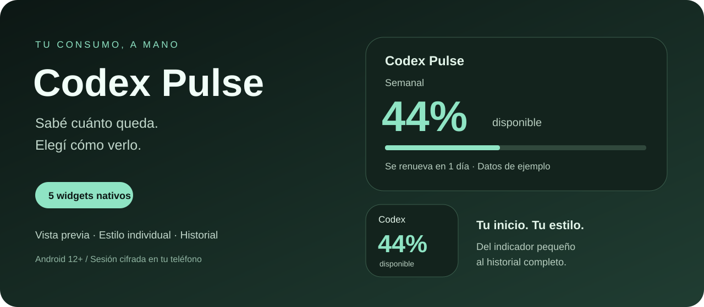
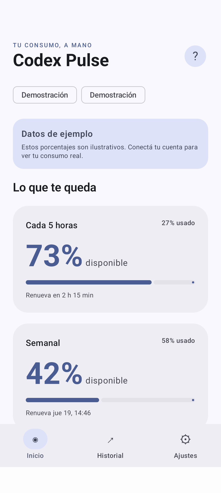
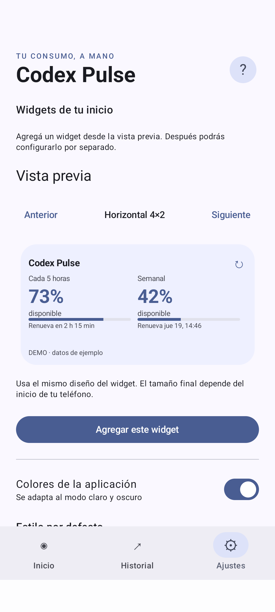

<p align="center"><strong>ANDROID · WIDGETS · PRIVACIDAD</strong></p>
<h1 align="center">Codex Pulse</h1>
<p align="center"><strong>Tu cuota de Codex. De un vistazo.</strong><br/>Consultá cuánto queda, cuándo se renueva y elegí cómo verlo en tu inicio.</p>
<p align="center">
  <a href="https://github.com/GermanBartoli/CodexPulse/releases"></a>
  
  
  
  <a href="https://github.com/GermanBartoli/CodexPulse/actions/workflows/android.yml"></a>
</p>
<p align="center"><a href="https://github.com/GermanBartoli/CodexPulse/releases">Descargar APK</a> · <a href="#primeros-pasos">Primeros pasos</a> · <a href="#tecnologías">Tecnologías</a> · <a href="#conexión-y-privacidad">Privacidad</a></p>



*Portada ilustrativa con datos de ejemplo. Aplicación comunitaria, no oficial ni afiliada a OpenAI.*

## Mirá antes de agregar

| Tu consumo | Tu próximo widget |
| --- | --- |
|  |  |

Capturas de la versión 0.5.0 obtenidas en un emulador Android 16, exclusivamente con datos de demostración. Se conservan los archivos originales, sin reducir su resolución. La versión 0.5.1 agrega la lista de widgets instalados debajo del consumo.

## Primeros pasos

1. Descargá la APK firmada desde [Releases](https://github.com/GermanBartoli/CodexPulse/releases). Cada versión incluye `SHA256SUMS.txt` para comprobar el archivo.
2. Abrila en Android 12 o posterior. Si Android lo solicita, autorizá a la aplicación desde la que abriste el archivo para instalar esta APK. No hace falta desactivar Play Protect.
3. Probá **Explorar la demostración** o usá **Conectar con ChatGPT**. Elegí tu navegador y completá el código de dispositivo en la página oficial.
4. En **Ajustes**, recorré las vistas previas y tocá **Agregar este widget**.
5. En **Inicio → Tus widgets agregados**, revisá los que ya tenés y abrí **Configurar** para personalizar cada uno.

Para actualizar, instalá la nueva APK sobre la anterior, sin desinstalar. La app conserva la sesión y los datos locales. No está publicada en Google Play; las versiones actuales son de prueba.

## Qué incluye

- Indicador 1×1: muestra el menor porcentaje disponible entre los límites recibidos.
- Semanal 2×2: muestra la cuota semanal cuando el servicio la informa.
- Dos límites 2×2: vista compacta de los límites recibidos.
- Horizontal 4×2: porcentajes, barras y próximas renovaciones.
- Historial 4×3: añade la evolución local de la cuota primaria.
- Pantallas separadas de Inicio, Historial y Ajustes.
- Tus widgets agregados: cantidad, nombre y configuración de cada instancia; la lista se actualiza al volver a la app y cada 15 segundos mientras está abierta.
- Vista previa con el diseño real del widget y botón para agregarlo al inicio.
- Diseño destacado para cuentas que informan una sola cuota, con porcentajes grandes.
- Configuración individual de cada widget desde Ajustes o desde el inicio, si el lanzador permite reconfigurarlo. Guardar aplica solo a ese widget; Cancelar conserva su estilo.
- Estilo por defecto para los widgets sin configuración propia: colores del teléfono o verde Pulse; fondo adaptable, oscuro o transparente.
- Indicador 1×1 configurable: menor disponibilidad, límite de cinco horas o semanal, sin sustituir cuotas ausentes.
- Historial con fechas, leyenda por cuota y filtros de 24 horas, 7 días o todas las consultas guardadas.
- Aplicación con modo claro y oscuro, colores del teléfono, actualización manual y demostración sin cuenta.
- Consulta automática configurable cada 15, 30 o 60 minutos, sujeta al ahorro de batería de Android.
- Historial de las últimas 96 consultas, cifrado y guardado únicamente en el dispositivo.
- Alertas opcionales al quedar 20% y 10%, una por umbral y período informado. Desactivadas inicialmente; requieren permiso de notificaciones.
- Demostración con historial ilustrativo, sin conectar una cuenta ni generar alertas.

Los tamaños son orientativos y dependen del lanzador. El historial empieza con las consultas de esta aplicación; no reconstruye el consumo anterior. Los porcentajes no representan un número fijo de tokens. Los tokens exactos por día no están disponibles mediante esta conexión.

## Conexión y privacidad

La autorización se realiza por código de dispositivo en https://auth.openai.com/codex/device. Las credenciales se ingresan solamente allí. Puede ser necesario habilitar este tipo de acceso en la configuración de ChatGPT. La aplicación no recibe la contraseña de la cuenta.

La sesión renovable se guarda cifrada con AES-GCM y una clave no exportable de Android Keystore. El historial también se cifra. Los archivos se excluyen de las copias de seguridad y transferencias del sistema. No se incluyen credenciales de OpenAI en el repositorio o la APK.

La app conecta directamente con auth.openai.com y chatgpt.com mediante HTTPS, sin servidor propio, publicidad ni analítica. No sigue redirecciones HTTP con credenciales. Los widgets no muestran correo, identificador de cuenta ni tokens. Las notificaciones ocultan los porcentajes en la pantalla bloqueada y se retiran al desactivar las alertas o borrar la sesión. Las marcas para evitar avisos repetidos también se cifran. La pantalla del código de acceso impide las capturas del sistema.

La opción de borrar datos elimina la sesión y el historial del teléfono y cancela las actualizaciones. No revoca otras sesiones de ChatGPT. Si el teléfono se pierde, revisar y cerrar las sesiones desde la cuenta oficial.

## Limitaciones

Esta es una aplicación comunitaria, no oficial ni afiliada a OpenAI. La consulta usa el servicio interno `/backend-api/wham/usage`; puede cambiar, rechazar accesos o dejar de funcionar. La compilación y las pruebas de demostración no verifican la autorización de una cuenta real. No se simulan porcentajes reales: la demostración se identifica explícitamente.

Si no hay red, se conserva el último dato con su hora y se informa el error. Una fecha de reinicio vencida no se interpreta como una cuota renovada hasta consultar nuevamente.

## Desarrollo

JDK 21, Android SDK API 37 para compilar, destino Android 16 (API 36), Android Gradle Plugin 9.5.0, Kotlin y Compose Compiler 2.4.21, Compose BOM 2026.09.00, Glance 1.2.0 y WorkManager 2.12.0. Kotlin está integrado mediante AGP, sin el complemento Android anterior.

En PowerShell, con JAVA_HOME y ANDROID_HOME configurados:

```powershell
.\gradlew.bat assembleDebug testDebugUnitTest lintDebug
.\gradlew.bat assembleDebugAndroidTest
adb install -r app/build/outputs/apk/debug/app-debug.apk
adb install -r app/build/outputs/apk/androidTest/debug/app-debug-androidTest.apk
adb shell am instrument -w com.germanbartoli.codexpulse.test/androidx.test.runner.AndroidJUnitRunner
```

Las órdenes de instalación y prueba requieren un dispositivo autorizado. La prueba ejecuta la demostración, verifica los cinco proveedores de widgets, renderiza sus vistas y prueba el borrado local. No debe ejecutarse sobre una sesión real: la prueba se omite si detecta una cuenta conectada.

Para publicar una APK firmada, definir PULSE_KEYSTORE y PULSE_STORE_PASSWORD únicamente en el entorno del proceso de compilación. El alias es codexpulse. La clave de firma debe conservarse fuera del repositorio para poder instalar futuras actualizaciones sobre la misma aplicación.

## Referencias

Se estudió la integración comunitaria de [Codex Usage Android](https://github.com/guberm/Codex-Usage-Android) para contrastar el protocolo de acceso y las cuotas. Ver [avisos de terceros](TERCEROS.md).

## Tecnologías

| Tecnología | Uso en la app |
| --- | --- |
| Kotlin 2.4.21 · Java 17 | Código Android; JDK 21 para compilar. |
| Jetpack Compose · Material 3 | Pantallas nativas, navegación y colores del teléfono. |
| Compose BOM 2026.09.00 | Versiones coordinadas de la interfaz. |
| Jetpack Glance 1.2.0 | Cinco widgets y sus vistas previas reales. |
| WorkManager 2.12.0 | Actualizaciones periódicas sujetas a las reglas de Android. |
| Android Keystore · AES-GCM | Sesión e historial cifrados dentro del dispositivo. |
| Android SDK 37 · destino API 36 | Compilación actual y destino Android 16; mínimo API 31. |
| AGP 9.5.0 · Gradle 9.9.1 | Compilación, pruebas y APK firmada. |
| JUnit · Compose UI Test | Pruebas unitarias y flujos en un emulador Android 16. |

## Automatizaciones

- **GitHub Actions:** compila, ejecuta pruebas y genera capturas con datos ficticios en Android 16.
- **Dependabot:** propone actualizaciones semanales de Gradle y GitHub Actions mediante pull requests. No se fusionan automáticamente. [Configuración oficial](https://docs.github.com/en/code-security/concepts/supply-chain-security/about-the-dependabot-yml-file).
- **Revisión de secretos:** comprueba patrones de credenciales y nombres de archivos sensibles en el historial de Git, sin imprimir sus valores. Es una comprobación preventiva, no una garantía de ausencia de secretos.

## Licencia

El código de Codex Pulse se publica bajo la [licencia MIT](LICENSE.md). Podés usarlo, modificarlo y redistribuirlo, incluso comercialmente, conservando el aviso de autoría y la licencia. Se entrega sin garantía. Los avisos de las partes adaptadas de otros proyectos se conservan en [TERCEROS.md](TERCEROS.md).

El texto legal original se conserva en inglés para mantener la licencia estándar reconocible. La licencia del código no otorga derechos sobre marcas ni acceso a servicios de terceros.

## Autoría

Creado por **[German Bartoli](https://github.com/GermanBartoli)**, con **Codex** como asistente de desarrollo y coautor de los cambios realizados con su ayuda. Los commits correspondientes incluyen el reconocimiento `Co-authored-by: Codex <noreply@openai.com>`.

Los créditos de terceros se conservan en [TERCEROS.md](TERCEROS.md). Para informar un problema, abrí un [issue](https://github.com/GermanBartoli/CodexPulse/issues) sin adjuntar tokens, códigos de acceso, correos ni archivos de sesión. Para datos sensibles, consultá [SECURITY.md](SECURITY.md).